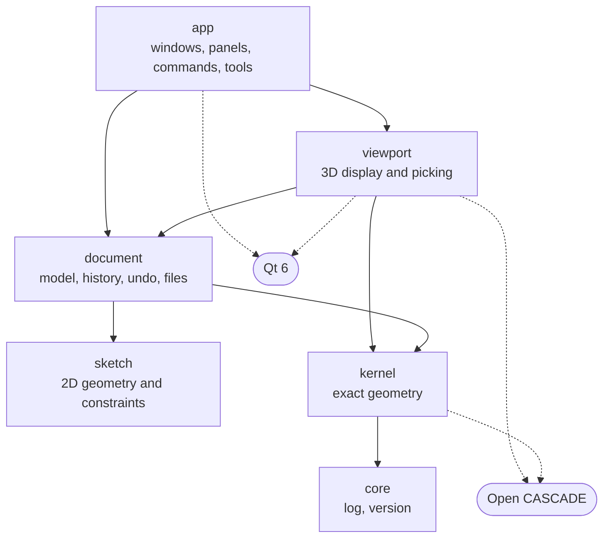

# Architecture

How LCAD is divided into modules, the rules between them, and the decisions made in Phase 0 with
the reasons for each. The product requirements are in [PROJECT_BRIEF.md](PROJECT_BRIEF.md).

## What exists today

Phases 0 and 1 built the desktop foundation, and each decision below rests on running code:

- `core` holds the log and LCAD's version.
- `kernel` makes boxes, cylinders, spheres, cones, and tori, moves shapes, measures them (volume,
  area, length, center of mass, bounding box, topology counts, validity), numbers their faces,
  edges, and vertices, and writes and reads them as bytes.
- `document` holds bodies with an undo history, and saves and opens `.lcad` files.
- `viewport` shows a document in OCCT's viewer inside a Qt widget, with camera navigation, a
  view cube, and selection of bodies, faces, edges, and vertices.
- `app` is the main window: top bar, toolbar, browser, viewport, timeline, and the panel for
  the command in progress.

Sketches, features, and everything after them are the plan the later phases build to.

## Modules



| Module | Responsibility | Status |
|---|---|---|
| `core` | What every module may use: the log and LCAD's version. | In place |
| `kernel` | Exact B-rep geometry: shapes, modeling operations, measurement, validity, tessellation, import and export. A thin layer over OCCT. | Primitives, measurement, and serialization in place |
| `sketch` | Sketch entities, constraints, and the adapter to the constraint solver. | Phase 2 |
| `document` | The model: components, bodies, sketches, parameters, and the feature history. Recompute, transactions and undo, saving and loading. | Bodies, undo, and files in place; features in Phase 3 |
| `viewport` | Displays the document's geometry and turns pointer input into picks and camera motion. Wraps OCCT's viewer in a Qt widget. | In place |
| `app` | Main window, browser, timeline, toolbars, the command system, and interactive tools. | Window and primitive commands in place |

Drawings, CAM, and scripting become modules of their own when their phases start. Each sits beside
`app` and uses `document` and `kernel` the same way.

### Rules

1. **Dependencies point one way.** A module may use the ones below it in the diagram and never
   the ones above.
2. **OCCT stays inside `kernel` and `viewport`.** No other module includes an OCCT header or
   names an OCCT type. The build enforces this: only those two modules link the OCCT targets, and
   OCCT's headers are not on anyone else's include path. `kernel` hands out its own `Shape`
   value; the few places that must reach the OCCT shape behind it include
   `lcad/kernel/occt/ShapeAccess.h`, which only compiles for modules that link OCCT.
3. **`core`, `kernel`, `sketch`, and `document` do not use Qt.** They build and test without a display,
   and can later serve a command-line tool or a scripting interface. The build enforces this too:
   they do not link Qt.
4. **The document is the single source of truth.** The viewport and the interface observe it and
   ask it to change. They hold no model state of their own. What they do hold is state of the
   session, not of the model: the camera and the selection belong to the viewport.
5. **Geometry is exact.** Measurement, validation, and export work on the B-rep. Triangle meshes
   exist only for display and for mesh export.

The cost of rule 2 is wrapper code: every OCCT capability LCAD uses needs a kernel function. The
return is that OCCT's API changes (the move to 8.x is a large one) are absorbed in one module, and
that the rest of the code reads in LCAD's own vocabulary.

## Decisions

Each was made on 2026-10-12 unless noted.

| # | Decision | Chosen | Revisit when |
|---|---|---|---|
| 1 | Geometry kernel | OCCT 7.6 to 7.9, behind `kernel` | A supported distribution ships OCCT 8 |
| 2 | Interface toolkit | Qt 6 Widgets | Not expected |
| 3 | Viewport | OCCT's own viewer inside a `QOpenGLWidget` | Large-assembly benchmarks in Phase 5; native Wayland |
| 4 | Document model | LCAD's own, not OCCT's application framework | Not expected |
| 5 | Native file format | A zip container of JSON and B-rep; see [FILE_FORMAT.md](FILE_FORMAT.md) | Not expected |
| 6 | Units | Millimeters and radians internally | Not expected |
| 7 | Errors | No OCCT exception leaves `kernel` | Not expected |
| 8 | Finding OCCT at build time | From headers and libraries, not OCCT's CMake package | Distributions fix their packages |
| 9 | Tests | Catch2 for units, Qt Test for the interface; see [TESTING.md](TESTING.md) | Not expected |
| 10 | License | GPL-3.0-or-later; see [DEPENDENCIES.md](DEPENDENCIES.md#lcads-own-license) | Not expected |
| 11 | Stable references to faces and edges | Open, designed at the start of Phase 3 | |
| 12 | Sketch solver | Open, chosen by a spike at the start of Phase 2 | |
| 13 | Undo | Reversible edits recorded by the document, grouped by transactions (2026-10-12, Phase 1) | Phase 3, when recompute arrives |
| 14 | Commands | A panel beside the viewport with a live preview, not a modal dialog (2026-10-12, Phase 1) | Not expected |

### 1. Geometry kernel

OCCT, used through `kernel`. The assessment is in [DEPENDENCIES.md](DEPENDENCIES.md).

### 2. Interface toolkit

Qt Widgets, not Qt Quick. LCAD's interface is a dense desktop layout of docked panels, tree
views, toolbars, and menus, which is what Widgets is built for, and embedding OCCT's viewer in a
`QOpenGLWidget` is a path other applications already use (Mayo, and OCCT's own Qt samples).

### 3. Viewport

<a id="viewport"></a>

**Chosen:** OCCT's interactive viewer (its `AIS` and `V3d` layers) drawing into a
`QOpenGLWidget`, hidden behind `viewport` so the rest of LCAD never sees it.

**Alternative:** a renderer written for LCAD.

**Why.** OCCT's viewer already does most of what Phase 1 asks of the viewport, and does it
directly from the B-rep: display meshes that follow the exact shape, picking of faces, edges, and
vertices with hover highlighting, a view cube, section planes, manipulators, and dimensions. A
custom renderer would spend months reaching the point where a face can be picked reliably. The
spike in this repository had a box on screen with orbit, pan, zoom, and hover highlighting in a
day, and it runs unchanged on all four tested distributions.

**What it costs.**

- *X11 only, for now.* Distributions build OCCT's viewer for GLX, so it needs an X11 connection.
  Under a Wayland session LCAD therefore runs through XWayland: `prepareApplication()` selects
  Qt's `xcb` platform plugin unless `QT_QPA_PLATFORM` is already set. This was tested on a GNOME
  Wayland session: through XWayland the viewer runs on the machine's GPU (OpenGL 4.6); with Qt's
  native Wayland plugin OCCT cannot adopt Qt's OpenGL context, and the viewport reports that
  instead of drawing. Native Wayland needs an OCCT built for EGL, which none of the
  distribution packages checked provide.
- *OCCT's look.* Rendering quality and style are bounded by what OCCT's renderer offers.
- *Unknown at scale.* Performance with large assemblies has not been measured. Phase 5 has to
  benchmark it; because of rule 2, replacing the renderer later touches `viewport` only.

**How the embedding works, and what goes wrong.** Qt owns the OpenGL context, the framebuffer,
and the buffer swap; OCCT adopts all three and draws when Qt asks the widget to paint. Five
details matter:

- OCCT insists on an X11 window to make the context current on, although nothing it draws goes
  there. The viewport gives it a hidden window of its own, which lives exactly as long as
  OCCT's view. Two other choices were tried and are wrong. A native window of the widget itself
  (`winId()`) was the first version of the spike: its own framebuffer looked right while the
  real window showed nothing, because Qt could no longer compose the widget with the menus
  around it. The window the widget is shown in (`effectiveWinId()`), which the upstream sample
  uses, belongs to the top-level widget, and Qt destroys and replaces that one on its own
  schedule; OCCT was then left making the context current on a window that no longer existed.
- The surface format (depth and stencil buffers) is made Qt's default before `QApplication`
  exists, so the top-level window's surface matches the viewport's. Without it the viewer still
  drew correctly in testing, but OCCT warned on every start that the window had no depth or
  stencil buffer.
- Qt and OCCT share one context and each changes OpenGL state the other relies on, so the widget
  resets that state before and after OCCT draws. This follows the upstream sample. Nothing LCAD
  draws yet depends on it: removing the reset breaks no current test.
- OCCT keeps the last frame and reuses it. After anything displayed changes, the view has to be
  told (`Invalidate()`), or the change does not appear until something else forces a redraw.
  The same goes for what is under the pointer: OCCT remembers where it last looked and does not
  look again while the pointer rests, so that memory is cleared whenever the scene changes.
- OCCT reports trouble on its own message channel and carries on. Those messages go to LCAD's
  log, and the interface tests fail on any warning, error, or OpenGL error among them. That is
  how the stale-window problem above was found: every picture looked right.

**Light and color.** Bodies are matte, with soft light from all sides and two lights that
travel with the camera, from the upper left and, weaker, from the right. OCCT's default of one
light straight ahead shades all three visible sides of a box alike in the isometric view, and
its default material turns a flat face that faces the camera plain white.

The technique follows the QOpenGLWidget sample maintained for OCCT; see
[THIRD_PARTY_NOTICES.md](../THIRD_PARTY_NOTICES.md).

### 4. Document model

**Chosen:** plain C++ classes owned by `document`, with LCAD's own transaction system for undo
and its own file format.

**Alternative:** OCAF, the application framework that ships with OCCT. It offers a document tree,
undo, persistence, and a naming service for sub-shapes.

**Why.** A history-based modeler is defined by its feature graph, its recompute rules, and how
references survive edits. Those need to be designed for LCAD's workflow and kept under LCAD's
control, including the file format and its migrations. Building on OCAF would also tie every
module that touches the document to OCCT, which rule 2 exists to prevent. OCAF's exchange
structures will still be used inside `kernel` where STEP import and export need them.

### 5. Native file format

One `.lcad` file per document: a zip container holding JSON for the model and binary B-rep for
geometry. The layout, versioning, and saving rules are in [FILE_FORMAT.md](FILE_FORMAT.md).

### 6. Units

Lengths are stored in millimeters and angles in radians, as `double`. A document's display unit
(millimeters or inches) is applied where values are shown or typed, and nowhere else. Parameters
carry their own units from Phase 3. OCCT is unitless and its tolerances assume a scale near
millimeters, which this matches.

### 7. Errors

- A wrong argument is the caller's mistake: `kernel` throws `std::invalid_argument`, as
  `makeBox` does for a size that is not a positive length.
- A kernel operation that cannot produce a result (bytes that are not geometry, and later a
  fillet too large for its edge or a boolean that fails) is an expected outcome. `kernel`
  throws `kernel::Error`, which says what was attempted and why it failed. From Phase 3 the
  recompute engine catches it per feature, marks that feature failed, and keeps the last valid
  model, as the brief requires.
- No OCCT exception crosses the `kernel` or `viewport` boundary. Every kernel call into OCCT
  that can fail runs inside `occt::guarded()`, which turns an OCCT exception into a
  `kernel::Error`. If the viewport cannot start, it shows an explanation and the rest of the
  window keeps working.
- A file that cannot be read or written is a `document::FileError`, whose text is a sentence
  for the user.
- OCCT's diagnostic messages, Qt's, and LCAD's own go to one log, kept by `core`. The
  application writes it to `~/.local/state/lcad/lcad.log`.

### 8. Finding OCCT at build time

`cmake/LcadOpenCascade.cmake` locates OCCT's headers and libraries itself. The CMake package
OCCT installs cannot be used as distributions ship it: on Ubuntu 24.04 its targets link
`libtbb.so` by absolute path with nothing depending on the package that provides the file, and
on Ubuntu 26.04 it refuses to load unless OCCT's separately packaged VTK bridge is installed.
Both failures showed up in CI on clean installs and not on a developer machine that happened to
have the extra packages.

### 11. Stable references (open)

When an early feature changes, later features must still find "that edge" and "that face". This
is the hardest problem in a parametric modeler and the usual reason such projects stall. OCCT
reports which faces each operation created or modified, which is the raw material; what to
build from it is designed at the start of Phase 3, before any feature that takes a face or edge
as input.

Phase 1 does not solve this and does not pretend to. A selected face is identified by its number
within one shape (`kernel::subShape()`), which is enough to measure what was clicked and
meaningless after the shape changes. Nothing stores these numbers.

### 13. Undo

**Chosen:** the document records each edit together with what is needed to reverse it. An edit
made on its own is one undo step. A `Transaction` groups several into one step, and reverts
them all if it is abandoned, which is how a command that fails halfway leaves the document as
it was.

**Alternative:** keeping a copy of the whole document per step. Simpler, and affordable while
shapes are shared between copies, but it gives no hook for telling observers what changed.

**Why.** The viewport and the browser follow the document change by change, and need to be told
which body was added, removed, or renamed, for undo as for the original edit. Undo history is
not saved with the document.

**Revisit** in Phase 3: an edit to a feature changes every later shape through recompute, and
undo then has to restore or recompute those results.

### 14. Commands

**Chosen:** a command's settings appear in a panel docked beside the viewport, the viewport
shows a see-through preview of the result, and the document changes only when the command is
accepted, as one undo step. The view can be turned and zoomed while the panel is open.

**Alternative:** a modal dialog per command, which is less code.

**Why.** The brief asks for minimal modal dialogs and visual feedback for the operation in
progress, and every modeling command to come (extrude, fillet, pattern) needs the same pattern.
Creating a primitive is its first user.

## Threads

The interface thread never runs a long geometry operation. Recompute runs on a worker thread and
hands finished shapes back, and long operations can be canceled and report progress.

One constraint from OCCT shapes this: meshing a shape for display stores the mesh inside the
shape's shared data, so a shape must not be meshed on one thread while another thread reads it.
The design for recompute in Phase 3 has to respect that.

## Source layout

```
cmake/              build helpers (finding OCCT and the file libraries, warning flags)
packaging/          launcher, icon, and file type
scripts/            install-deps.sh, build-appimage.sh, smoke-test-appimage.sh
src/<module>/
    include/lcad/<module>/   the module's public headers
    src/                     its implementation
tests/
    core/, kernel/, document/   unit tests (Catch2), no display needed
    gui/            interface tests (Qt Test), run on a virtual display
    models/         reference documents the tests read
    support/        shared tolerances, frame checks, and helpers
docs/
```

Code is C++20. Formatting is whatever `clang-format` produces from `.clang-format`. Types are
`PascalCase`, functions and variables `camelCase`, private members `m_name`, and a file is named
after the class it holds.
